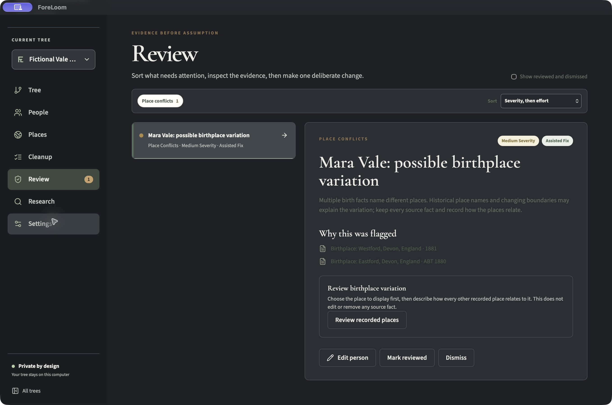
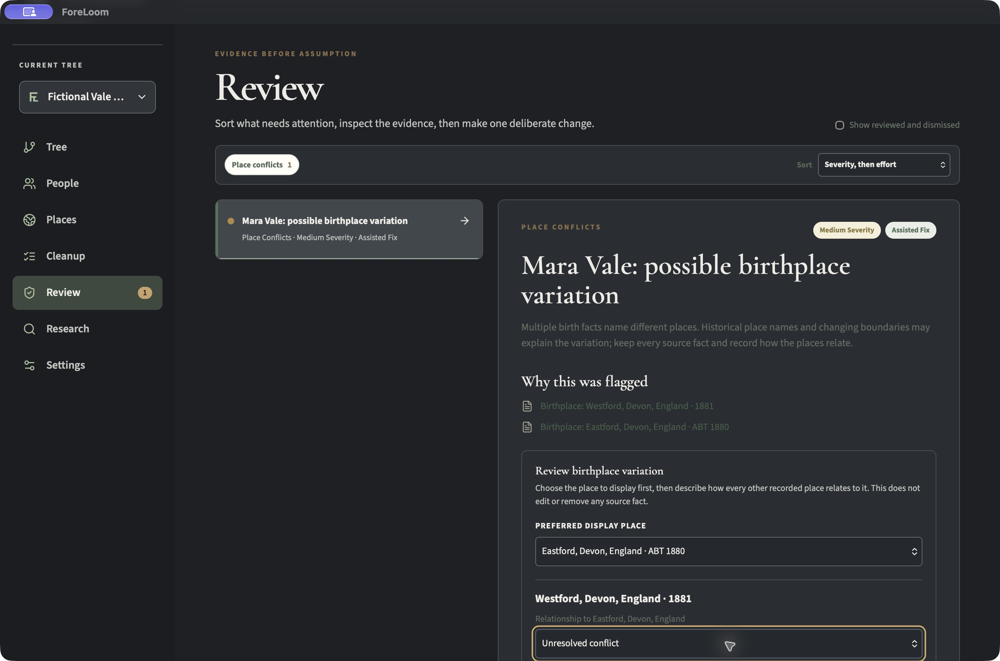
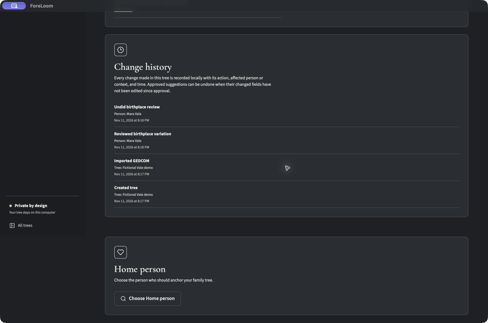
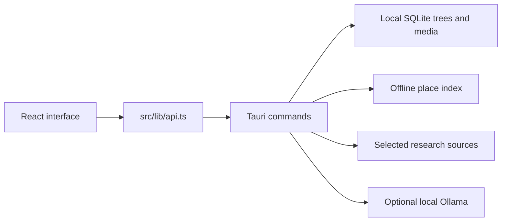

# ForeLoom

**Explore a family tree while keeping its evidence close.** ForeLoom is a local-first genealogy research prototype for people working from a GEDCOM export. It imports the export into a separate SQLite tree, shows relationships and places, flags records for review, and keeps source facts alongside review decisions. It is a portfolio code example, not a launched or validated product.

## Project and thesis

Family research often starts with an inherited or exported tree whose facts are incomplete, approximate, or contradictory. A date may be recorded as “about 1880”; two sources may name different birthplaces; an apparent duplicate may be a different person. The initial hypothesis was that a private desktop workspace could turn these ambiguities into reviewable decisions: import the tree, flag possible problems, show the underlying evidence, and let the researcher decide whether to act.

The product constraint was **local control**. Trees, imported media, review decisions, and backups live on the user's computer. External research happens only after the user starts a search; optional AI runs through a local Ollama instance and cannot edit the tree. Deterministic rules generate the issue queue, so the same saved facts produce the same review prompts without relying on a model.

I designed and built the prototype as a solo project. The intended user was a family researcher maintaining a private tree, not an organization buying an archive platform. The app tests an evidence-led workflow; it does not establish genealogical truth.

## What the prototype demonstrates

The [fictional GEDCOM](docs/screenshots/demo.ged) contains two conflicting birthplace entries for one invented person. ForeLoom previews and imports it into a new tree, flags the variation, displays both source facts, records a chosen review outcome, and can undo that decision. The screenshots below show this sequence. Choosing a display place does not delete the other entry or prove which source is correct.

This flow shaped the implementation: uncertain date text is retained instead of silently made exact; issue detection is rule-based; import keeps the original export intact; and review changes have a local history with undo. These are implementation choices visible in the code and demo, not measured improvements in researcher accuracy or speed.

## Why the paid product plan was stopped

The original commercial idea was a paid cleanup and AI research assistant for imported family trees. A source-based market review weakened that position. [RootsMagic documents problem searches and research tasks](https://help.rootsmagic.com/RM12/problem-search.html); [Gramps documents detailed source and citation management](https://www.gramps-project.org/wiki/index.php/Features); [FamilySearch offers AI-assisted full-text record search](https://www.familysearch.org/en/help/helpcenter/article/how-do-i-use-fulltext-search); and [MyHeritage describes GAIA as searching records, comparing evidence, and suggesting next steps](https://blog.myheritage.com/2026/11/introducing-gaia-myheritages-groundbreaking-genealogy-ai-agent/). These are published capabilities, not a hands-on comparison of quality. They made “cleanup plus AI” too broad a claim to justify a paid roadmap without evidence of a distinct job and buyer.

The export workflow also limited a proposed Ancestry use case. [Ancestry says GEDCOM files omit media and an upload creates a new tree rather than merging changes into the original](https://help.ancestry.com/hc/en-us/articles/53933314587411-Moving-Trees-Between-Accounts). That made a simple “clean your Ancestry tree and send it back” promise unreliable.

I withdrew the proposed Pro pricing, checkout, and launch work. **ForeLoom remains a noncommercial, open-source prototype; the commercial direction was stopped, not the codebase.** A possible narrower record-location task remains a research hypothesis. Before reviving a paid product, I would require a specific recurring task, a complete comparison with existing workflows, lawful access to the needed records, and a small demonstration with observable paid intent. None of that demand has been validated.

### Claims and evidence

| Statement | Evidence level |
| --- | --- |
| Import, review, decision, and undo work for the included fictional tree | Demonstrated in this prototype and the screenshots below |
| Rules, local storage, and reversible review are implemented | Source code and automated tests; not a large-tree or cross-platform benchmark |
| Existing tools cover parts of the proposed paid position | Vendor documentation and product claims; not hands-on competitive testing |
| A narrower record-location product might be viable | Untested hypothesis; no customer or revenue evidence |

## Major features

- **Local family trees:** create separate SQLite trees; edit people, relationships, uncertain dates, name variants, notes, sources, citations, and media.
- **GEDCOM import:** preview counts and warnings, then import a GEDCOM or ZIP containing one into a new tree while preserving the original file.
- **Evidence review:** flag chronology, duplicate, relationship, and birthplace issues with deterministic rules; inspect source facts, record a decision, and undo eligible changes.
- **Place exploration:** browse family places on a map and review matches against an offline place index.
- **Research workspace:** search selected public sources only when requested, compare tentative leads, and capture cited findings.
- **Portable backup:** export a tree to ZIP and restore it as a separate tree.
- **Optional local AI:** use [Ollama](https://ollama.com/) for explanations and suggestions. Core editing and issue checks work without it; AI does not directly edit a tree.

## Expanded demo tree

Import the [expanded fictional GEDCOM](docs/demo-expanded.ged) in the desktop app for a larger walkthrough: 25 people, seven families, 39 imported relationships, three fictional sources, four generations, and places across England, Wales, and the United States. The original [small screenshot fixture](docs/screenshots/demo.ged) remains available for reproducing the screenshots.

The expanded file deliberately includes a death year keyed as **1868 instead of 1968** for Jonah Vale, two recorded birthplaces for Mara Vale, a duplicate Ruth Marsh record, an impossible parent age for Ada Vale and Helen Vale, and one unlinked person. The source note attached to Jonah's death records the intended year, so **Review** can flag the chronology error and local AI can propose a fact edit using that evidence. Start Ollama and select a model in **Settings** to see AI suggestions. Review and apply each proposed change in the UI; AI never applies changes automatically. The duplicate merge also requires confirmation, while birthplace and relationship issues need a person to assess the evidence.

## Screenshots

These show a [fictional GEDCOM](docs/screenshots/demo.ged) with one person and two conflicting birthplace entries. The screenshots demonstrate a review decision, not a verified historical conclusion.

| Inspect the source facts | Choose a review outcome |
| --- | --- |
|  |  |

| Recorded decision | After undo |
| --- | --- |
|  |  |

## Technology

- **Desktop:** Tauri 2, Rust, SQLite, and typed Tauri commands.
- **Interface:** React 19, TypeScript, Vite, Tailwind CSS, Radix UI primitives, and MapLibre GL.
- **Data and checks:** local GEDCOM parsing, an offline GeoNames place index, Vitest for frontend tests, and Rust unit tests.

## Run the desktop app

Download the latest build from [GitHub Releases](https://github.com/weber-stephen/foreloom-app/releases/latest). Choose the Apple Silicon or Intel `.dmg` for your Mac, or the Windows `.exe` installer. These prototype builds have no developer certificate or notarization. macOS may require approval in **Privacy & Security**; Windows may show a SmartScreen warning.

To run from source instead, install Node.js 22, Python 3, [Rust through rustup](https://rustup.rs/), and the [Tauri 2 prerequisites](https://v2.tauri.app/start/prerequisites/) for your OS. Put rustup's `cargo` and `rustc` ahead of system or Homebrew versions on `PATH` (normally `~/.cargo/bin`). The pinned Rust version is in `rust-toolchain.toml`.

```sh
npm ci
python3 scripts/prepare_gazetteer.py
npm run tauri dev
```

The preparation step verifies and expands the bundled, approximately 40 MB compressed GeoNames place index. When the desktop window opens, create a tree or import a GEDCOM you exported from your own tree. Open **Review** to examine flagged records and **Settings** to create a backup. `npm run dev` serves only the frontend; native storage and file dialogs require Tauri.

No `.env` file or API key is required for the core app. The optional `VITE_ENABLE_DATA_CLEANUP=true` build setting exposes the data cleanup UI. The optional, ignored Rust test for a personal export reads `KINFOLK_GEDCOM_FILE`; do not commit that export.

## How it works



The React entry point is `src/main.tsx`; `src/App.tsx` hosts the main workflows. Rust commands in `src-tauri/src/lib.rs` call the import, storage, issue, place, and research modules. See [architecture](docs/architecture.md) for a change map and data flow.

## Checks

```sh
npm test
npm run build
cd src-tauri && cargo test --locked
```

The frontend build includes TypeScript checking. Before a desktop bundle, run `python3 scripts/prepare_gazetteer.py` and then `npm run tauri build`. If Cargo reports that it cannot read lockfile version 4, check `which cargo` and put rustup first on `PATH`. If the place index is missing, rerun the preparation script. The prototype has been exercised on macOS. The limits below describe what these checks do not establish.

To publish desktop builds, update the matching versions in `package.json`, `src-tauri/tauri.conf.json`, and `src-tauri/Cargo.toml`, then push a `v<version>` tag (for example, `v0.1.0`). The [release workflow](.github/workflows/release.yml) builds Apple Silicon and Intel macOS DMGs and a Windows installer, uploads them to a draft GitHub Release, and publishes it after all builds succeed.

## Prototype limits

- **Compatibility:** Windows packaging and representative real-world GEDCOM imports have not been validated. The included fictional file is a demonstration fixture.
- **Reliability:** backup and restore have automated coverage, but recovery across machines has not been drilled; responsiveness on very large trees has not been benchmarked.
- **Accessibility:** a full keyboard and screen-reader review is still needed.
- **AI and sources:** Ollama output has not been evaluated across models, and external source coverage, permissions, and availability can change.
- **Release and product evidence:** this is an unsigned prototype, without validated customer outcomes or paid demand.

## Privacy and licensing

Trees and imported media live in local app-data storage. Research queries go to the selected source only when a search is started. The app sends no product analytics or usage events; legacy analytics consent and installation ID values are removed on startup. Optional AI requests go to Ollama at `127.0.0.1:11434`.

The app code is [MIT licensed](LICENSE). Bundled data, fonts, and icons retain their own terms; see [third-party notices](docs/third-party-notices.md). Please review [contributing](CONTRIBUTING.md) and [security reporting](SECURITY.md) before opening a change or vulnerability report.
