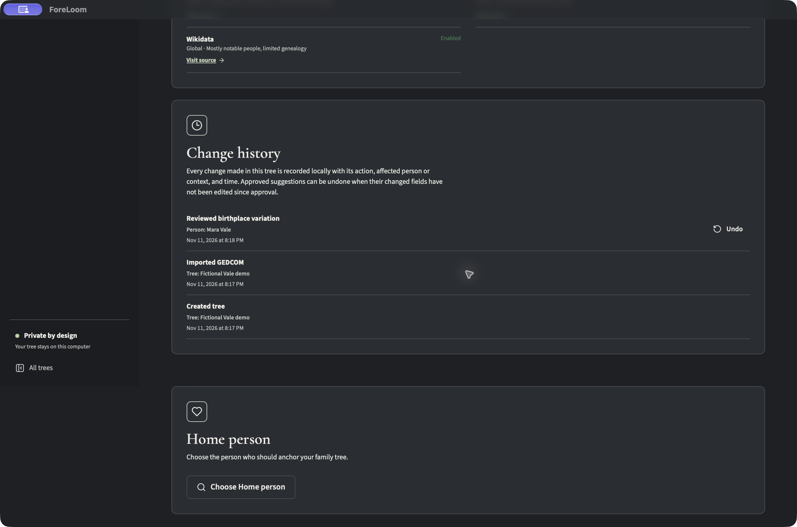
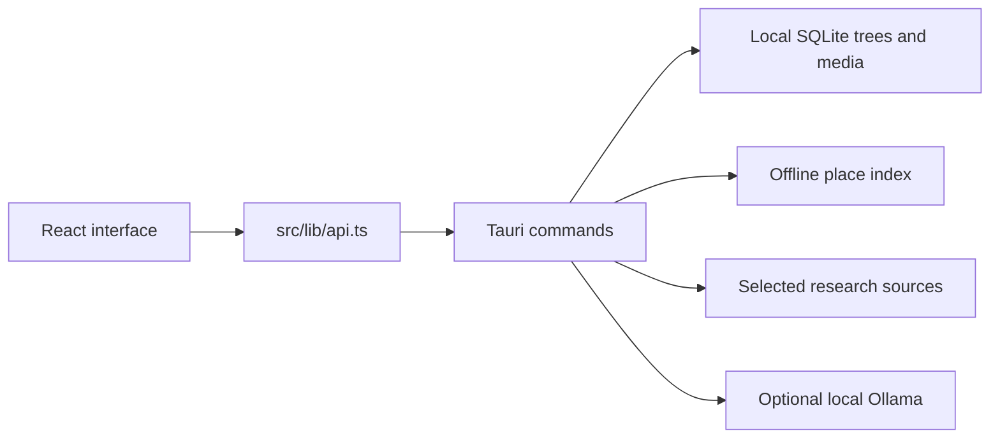

# ForeLoom

**Explore a family tree while keeping its evidence close.** ForeLoom is a local-first genealogy research prototype for people working from a GEDCOM export. It imports the export into a separate SQLite tree, shows relationships and places, flags records for review, and keeps source facts alongside review decisions. It is a portfolio code example, not a launched or validated product.

## Major features

- **Local family trees:** create separate SQLite trees; edit people, relationships, uncertain dates, name variants, notes, sources, citations, and media.
- **GEDCOM import:** preview counts and warnings, then import a GEDCOM or ZIP containing one into a new tree while preserving the original file.
- **Evidence review:** flag chronology, duplicate, relationship, and birthplace issues with deterministic rules; inspect source facts, record a decision, and undo eligible changes.
- **Place exploration:** browse family places on a map and review matches against an offline place index.
- **Research workspace:** search selected public sources only when requested, compare tentative leads, and capture cited findings.
- **Portable backup:** export a tree to ZIP and restore it as a separate tree.
- **Optional local AI:** use [Ollama](https://ollama.com/) for explanations and suggestions. Core editing and issue checks work without it; AI does not directly edit a tree.

## Screenshots

These show a [fictional GEDCOM](docs/screenshots/demo.ged) with one person and two conflicting birthplace entries. The screenshots demonstrate a review decision, not a verified historical conclusion.

| Inspect the source facts | Choose a review outcome |
| --- | --- |
|  |  |

| Recorded decision | After undo |
| --- | --- |
|  |  |

## Technology

- **Desktop:** Tauri 2, Rust, SQLite, and typed Tauri commands.
- **Interface:** React 19, TypeScript, Vite, Tailwind CSS, Radix UI primitives, and MapLibre GL.
- **Data and checks:** local GEDCOM parsing, an offline GeoNames place index, Vitest for frontend tests, and Rust unit tests.

## Run the desktop app

Install Node.js 22, Python 3, [Rust through rustup](https://rustup.rs/), and the [Tauri 2 prerequisites](https://v2.tauri.app/start/prerequisites/) for your OS. Put rustup's `cargo` and `rustc` ahead of system or Homebrew versions on `PATH` (normally `~/.cargo/bin`). The pinned Rust version is in `rust-toolchain.toml`.

```sh
npm ci
python3 scripts/prepare_gazetteer.py
npm run tauri dev
```

The preparation step verifies and expands the bundled, approximately 40 MB compressed GeoNames place index. When the desktop window opens, create a tree or import a GEDCOM you exported from your own tree. Open **Review** to examine flagged records and **Settings** to create a backup. `npm run dev` serves only the frontend; native storage and file dialogs require Tauri.

No `.env` file or API key is required for the core app. The optional `VITE_ENABLE_DATA_CLEANUP=true` build setting exposes the data cleanup UI. The optional, ignored Rust test for a personal export reads `KINFOLK_GEDCOM_FILE`; do not commit that export.

## How it works



The React entry point is `src/main.tsx`; `src/App.tsx` hosts the main workflows. Rust commands in `src-tauri/src/lib.rs` call the import, storage, issue, place, and research modules. See [architecture](docs/architecture.md) for a change map and data flow.

## Checks

```sh
npm test
npm run build
cd src-tauri && cargo test --locked
```

The frontend build includes TypeScript checking. Before a desktop bundle, run `python3 scripts/prepare_gazetteer.py` and then `npm run tauri build`. If Cargo reports that it cannot read lockfile version 4, check `which cargo` and put rustup first on `PATH`. If the place index is missing, rerun the preparation script. The prototype has been exercised on macOS. The limits below describe what these checks do not establish.

## Prototype limits

- **Compatibility:** Windows packaging and representative real-world GEDCOM imports have not been validated. The included fictional file is a demonstration fixture.
- **Reliability:** backup and restore have automated coverage, but recovery across machines has not been drilled; responsiveness on very large trees has not been benchmarked.
- **Accessibility:** a full keyboard and screen-reader review is still needed.
- **AI and sources:** Ollama output has not been evaluated across models, and external source coverage, permissions, and availability can change.
- **Release and product evidence:** this is an unsigned prototype, without validated customer outcomes or paid demand.

## Privacy and licensing

Trees and imported media live in local app-data storage. Research queries go to the selected source only when a search is started. The app sends no product analytics or usage events; legacy analytics consent and installation ID values are removed on startup. Optional AI requests go to Ollama at `127.0.0.1:11434`.

The app code is [MIT licensed](LICENSE). Bundled data, fonts, and icons retain their own terms; see [third-party notices](docs/third-party-notices.md). Please review [contributing](CONTRIBUTING.md) and [security reporting](SECURITY.md) before opening a change or vulnerability report.
